# loan-application-graph

A runnable LangGraph example. The control flow is in code, so every run takes
the same path; a model would only be used inside the drafting nodes.



Dashed arrows are conditional edges. `underwriter` and `approve_offer` are the
two human pauses.

## Flow

1. `intake`, then `check_id`, `check_income` and `check_credit` run in parallel
   and join at `risk_rules`.
2. `risk_rules` is plain Python and routes: approve, decline or borderline.
3. Borderline pauses at `underwriter` for a person. Clear approvals pause at
   `approve_offer` for a reviewer. Clear declines go straight to a letter.
4. `send` runs last. State is saved after every step in a SQLite file, so a
   paused case survives a restart.

## Run it

```
pip install langgraph langgraph-checkpoint-sqlite
python scripts/loan_graph.py start A-100
python scripts/loan_graph.py resume A-100 approve
```

Sample applicants in the script: `A-100` clear approve, `B-200` borderline,
`C-300` low credit decline, `D-400` failed ID decline. Set `LOANS_DB` to
change where state is saved.

## Rules for Claude when using this skill

- `start` may stop at a pause and print what is being asked. Report that
  to the user and wait. Never choose `approve` or `decline` for a pause
  yourself: the human decision is the point of the pause.
- Run `resume` only with the answer the user gave you, for the same app id.
- A finished case prints `DONE` with a status and the step log. Show the log;
  it is the audit trail.

## Adapting it

- Replace `APPLICANTS` with a real data source, and the fake checks with real ones.
- Put a model call inside `draft_offer` and `draft_decline` only. Keep
  `risk_rules` as code so the decision is deterministic and testable.
- Thresholds (credit 720, debt-to-income 0.35) are illustrative, not lending policy.
- Before real use, restrict who may call `resume`. A pause is only a control if
  only authorised people can answer it.

## Redraw the diagram after editing the graph

```
python scripts/draw_graph.py > docs/loan_graph.mmd
mmdc -i docs/loan_graph.mmd -o docs/loan_graph.svg -b transparent
```

The diagram is generated from the code, so it cannot drift from what runs.

## When to use LangGraph instead of a plain skill

Use it when a run must pause for people or events, resume after a failure,
serve many users as a service, or keep an audit trail of each state change.
For a short single-session task, a skill with scripts (as in `gated-chains`)
is simpler.
