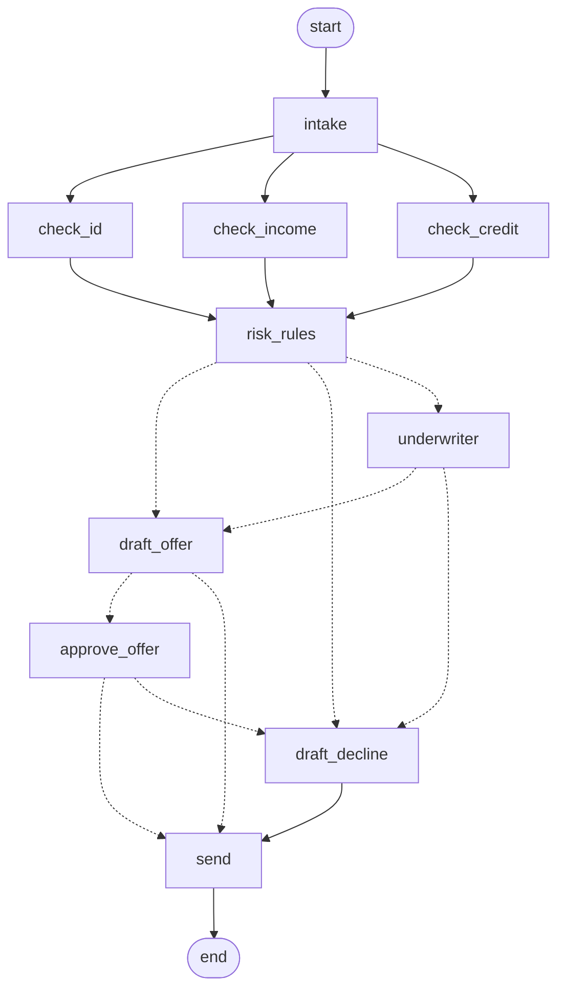

# claude-agentic-workflows

Claude Code skills and agents for agentic workflows.

## system-diagram

Draws AWS architecture and flow diagrams as animated SVG from a JSON spec of
components and connections. Graphviz does the layout, the `diagrams` package
supplies AWS icons, and a script adds step-by-step flow animation (reveal,
flowing dashes, moving packet dot, node pulse).

- Skill: `.claude/skills/system-diagram/` (see `SKILL.md` and `spec.md`)
- Agent: `.claude/agents/diagram-architect.md` (description -> `spec.json`)
- Example: `.claude/skills/system-diagram/examples/aws_web_app.json`, with
  rendered `aws_web_app.svg` and `aws_web_app.animated.svg`

### Setup

    apt install graphviz        # or: brew install graphviz
    pip install diagrams graphviz lxml

### Usage

    python .claude/skills/system-diagram/scripts/validate_spec.py spec.json
    python .claude/skills/system-diagram/scripts/render_diagram.py spec.json out/diagram
    python .claude/skills/system-diagram/scripts/animate_svg.py spec.json out/diagram.svg out/diagram.animated.svg

Or ask Claude Code to draw an architecture and it follows `SKILL.md`.

## loan-application-graph

A runnable LangGraph example: parallel checks, rule-based routing, two human
pauses, and saved state so a paused case can resume later or after a restart.
No API key needed (the data and letters are fake).

- Skill: `.claude/skills/loan-application-graph/` (see `SKILL.md`)
- Graph, generated from the code (dashed = conditional edges; `underwriter` and
  `approve_offer` are the human pauses):

    pip install langgraph langgraph-checkpoint-sqlite
    python .claude/skills/loan-application-graph/scripts/loan_graph.py start A-100
    python .claude/skills/loan-application-graph/scripts/loan_graph.py resume A-100 approve

## gated-chains, incident-summary, terraform-change-gates

Prompt chains with gates between steps. `gated-chains` defines the gate types
(script, rule, judge, human), the exit-code contract (0 pass, 1 retry,
2 escalate) and `gate_runner.py`, which enforces a retry budget, fails closed
on crashes and timeouts, and writes an audit log.

- `incident-summary`: alert and logs to an on-call summary. Gates reject
  invented log ids, out-of-order events and uncited claims; `summary-checker`
  is the judge agent.
- `terraform-change-gates`: fmt/validate/plan gate, then a rule gate on the plan
  that escalates any delete or replace, world-open ingress (other than 80/443)
  and oversized blast radius. `pr-reviewer` is the judge agent. Never runs apply.

Each skill has sample data in `examples/` to try the gates on.
Not built yet: refund-triage and snyk-fix skills.

## study-coach, subagent-delegation, router-agent, tool-chain

Small sample skills for common agent patterns. All use only the portable
`name` and `description` frontmatter fields.

- `study-coach`: short explanations, quizzes and a weak-spot list (`quiz-formats.md` loads on demand).
- `subagent-delegation`: send broad file reading to a subagent and keep only a short summary.
- `router-agent`: classify a request and hand it to one specialist.
  `examples/complexity_router.py` routes simple tasks to one cheap call and
  complex tasks to a five-agent orchestration, escalating when unsure.
- `tool-chain`: fixed pipeline where each step is checked before the next runs.

Notes from the session that produced them: `learning/2026-11-11-agent-design-notes.md`.
