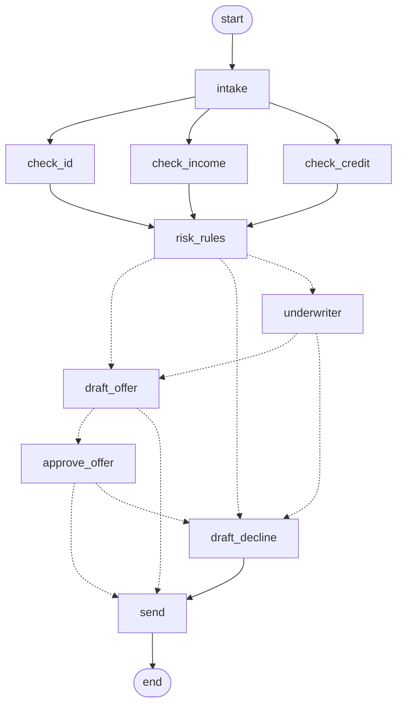

# claude-agentic-workflows

Claude Code skills and agents for agentic workflows.

## system-diagram

Draws AWS architecture and flow diagrams as animated SVG from a JSON spec of
components and connections. Graphviz does the layout, the `diagrams` package
supplies AWS icons, and a script adds step-by-step flow animation (reveal,
flowing dashes, moving packet dot, node pulse).

- Skill: `.claude/skills/system-diagram/` (see `SKILL.md` and `spec.md`)
- Agent: `.claude/agents/diagram-architect.md` (description -> `spec.json`)
- Example: `.claude/skills/system-diagram/examples/aws_web_app.json`, with
  rendered `aws_web_app.svg` and `aws_web_app.animated.svg`

### Setup

    apt install graphviz        # or: brew install graphviz
    pip install diagrams graphviz lxml

### Usage

    python .claude/skills/system-diagram/scripts/validate_spec.py spec.json
    python .claude/skills/system-diagram/scripts/render_diagram.py spec.json out/diagram
    python .claude/skills/system-diagram/scripts/animate_svg.py spec.json out/diagram.svg out/diagram.animated.svg

Or ask Claude Code to draw an architecture and it follows `SKILL.md`.

## loan-application-graph

A runnable LangGraph example: parallel checks, rule-based routing, two human
pauses, and saved state so a paused case can resume later or after a restart.
No API key needed (the data and letters are fake).

- Skill: `.claude/skills/loan-application-graph/` (see `SKILL.md`)
- Graph, generated from the code (dashed = conditional edges; `underwriter` and
  `approve_offer` are the human pauses):

    pip install langgraph langgraph-checkpoint-sqlite
    python .claude/skills/loan-application-graph/scripts/loan_graph.py start A-100
    python .claude/skills/loan-application-graph/scripts/loan_graph.py resume A-100 approve
