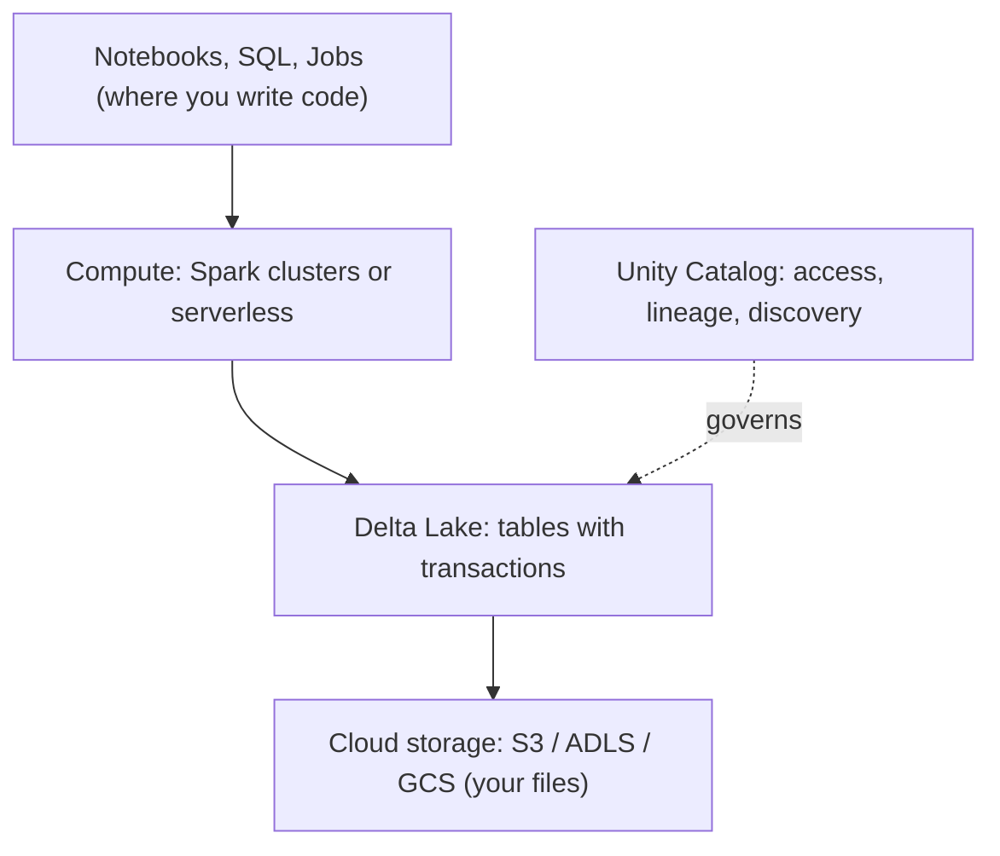
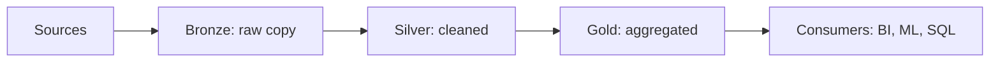
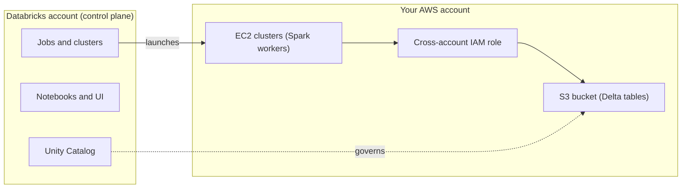

# Databricks basics (data engineering first)

Starting point: I know SQL, Python and cloud. Goal: data engineering first, then other areas.

## The problem it solves

- A data lake is cheap files that hold anything, but it is messy and has no transactions.
- A data warehouse gives fast SQL, but only for structured data, and it is another copy.
- The lakehouse idea: keep one copy of the data as files in your own cloud storage, and add table features on top (transactions, SQL, governance).

## The layers

| Piece | What it is |
|---|---|
| Spark | Splits one big job across many machines. Lazy: nothing runs until an action such as `.show()` or `.write`. Avoid row-by-row Python loops. |
| Delta Lake | Parquet files plus a transaction log. Gives ACID transactions, `MERGE`, schema enforcement and time travel. |
| Compute | Clusters (VMs in your cloud) that can auto-terminate, or serverless. Storage and compute are separate. |
| Notebooks | Browser notebooks mixing Python and SQL. |
| Workflows | Scheduler for notebooks, scripts and pipelines. |
| Unity Catalog | Governance. Tables are `catalog.schema.table`, for example `main.sales.orders`. Controls permissions, tracks lineage, makes data searchable. |

## Medallion pipeline (the pattern to build first)

Bronze is loaded with Auto Loader, silver is PySpark or SQL cleaning, gold is SQL rollups.

## Delta Lake transaction log

Each change adds one entry to `_delta_log`, and the log decides which files make up the table.

| Version | Change | Table contains |
|---|---|---|
| 0 | add file A | A |
| 1 | add file B | A, B |
| 2 | swap A for C (update) | B, C |

Time travel: `SELECT * FROM t VERSION AS OF 1`. A failed write never leaves half-finished data.

## How it sits on AWS

Databricks does not replace AWS and nothing is installed in your account. It is a hosted service that you give permission to create machines in your account.

One-time setup: sign up, create a cross-account IAM role and an S3 bucket (VPC is optional), paste the role ARN into Databricks, workspace is ready.

Each time a job runs: Databricks assumes your role, EC2 instances launch as a Spark cluster, the job runs, the instances shut down. Your data stays in S3, only compute comes and goes. Serverless compute runs in Databricks' own account instead. On Azure the same picture uses ADLS and Azure VMs, on GCP it uses GCS and Compute Engine.

## How the worker machines are secured

- Workers boot from a Databricks-managed AMI. Databricks patches it and ships new images, typically every 2 to 4 weeks. Users cannot choose older images.
- Databricks publishes CIS Level 1 hardened images.
- New workspaces use secure cluster connectivity: no open ports in your VPC and no public IPs on cluster nodes. Control plane connections use TLS with certificate pinning.
- Your part: a tight IAM policy, VPC rules, and restarting clusters to pick up new images (or turning on automatic cluster update).
- Optional compliance security profile adds a hardened image, extra monitoring agents and TLS 1.2 or higher.

## Sources

- [Databricks enhanced security monitoring](https://learn.microsoft.com/azure/databricks/security/privacy/enhanced-security-monitoring)
- [Databricks platform security whitepaper](https://www.databricks.com/wp-content/uploads/2022/02/databricks-security-and-trust-overview-whitepaper.pdf)
- [Databricks shared responsibility model (AWS)](https://databricks.com/sites/default/files/2025-02/databricks-shared-responsibility-model-aws.pdf)
- [Databricks security architecture on AWS](https://answers.databricks.com/databricks-security-architecture-aws)
- [Compliance security profile](https://learn.microsoft.com/azure/databricks/security/privacy/security-profile)
