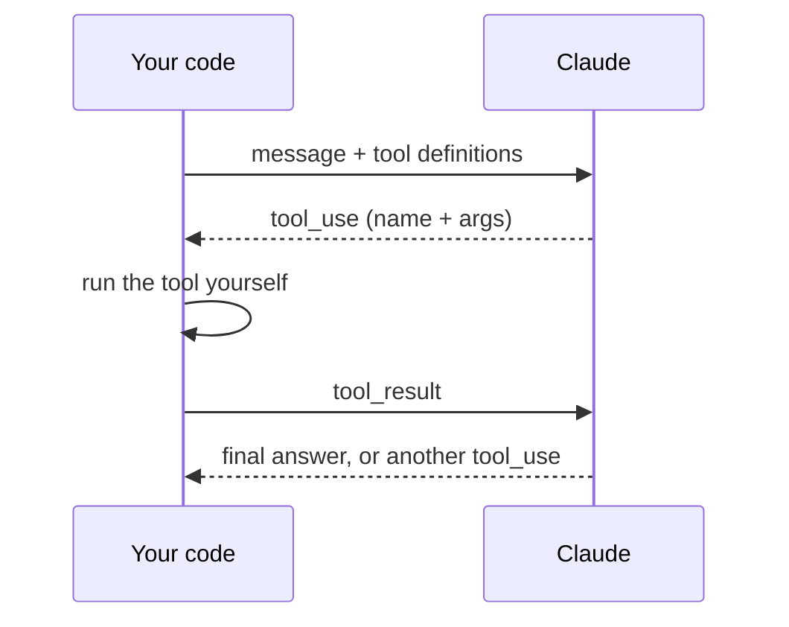

# Context window and how tool use works

## What fills the context window

The context window is everything Claude can consider in one request. Claude does not remember anything between requests, so the whole conversation is sent again every time.

| Piece | Behavior |
|---|---|
| System prompt | Fixed, resent every request |
| Tool definitions | Fixed, resent every request |
| Earlier messages | Grows every turn |
| Tool calls and results | Grows every tool call, can be large |
| Your latest message | Current request |
| Free space | Needed for Claude's reply |

Start of a chat: small stack, lots of free space. After several tool calls: history and tool results have grown and little room is left. The window limit varies by model and covers input plus output together.

## How a tool call works

Claude never runs a tool. It writes a structured request (tool name plus arguments) and your code runs it.

Steps 2 to 4 repeat until Claude stops asking for tools.

## Things to remember

- A tool call is only text. The tool's output goes back into the context as more text.
- Every step costs context: definitions, Claude's request and your result all stay in the history.
- Some tools run on the API side (the built-in tool search, web search). Claude calls them and the API runs them, so you never answer those calls. Never return a `tool_result` for a `srvtoolu_...` id.

## When the window gets full

- Trim or summarize big tool results.
- Summarize old turns (see `03-summarizing-conversations.md`).
- Load tool definitions on demand (see `02-dynamic-tool-loading.md`).
- Hand sub-tasks to a sub-agent with its own fresh window.
