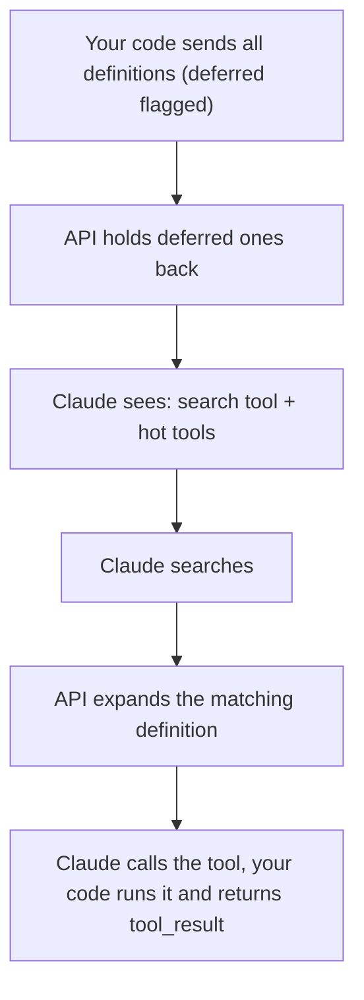

# Dynamic tool loading

## The exam-style problem

An enterprise agent integrates thousands of internal tools. Loading every tool definition uses a huge share of the context before any request runs. That slows responses and confuses tool selection. Options: tighter descriptions, a bigger model, or something structural.

Best answer: on-demand tool discovery (tool search, also called deferred tool loading). Keep one small search tool in context and load only the definitions a request needs.

Why the other options fall short:

- Tighter descriptions trim tokens by a percentage. Thousands of slightly shorter definitions are still far too many, and the model still sees every lookalike candidate.
- A bigger model does not change the design. Every request still pays the loading cost, and similar tools stay easy to confuse.

The cause is structural: the cost grows with the number of tools, whatever the request is.

## Example (operations)

Request: "Checkout API is slow. Find out why and page on-call."

1. `tool_search("service latency metrics")` loads `get_service_metrics`.
2. `tool_search("recent deployments")` loads `list_recent_deploys`.
3. `page_oncall` is a "hot" tool that is always loaded.

Three definitions in context, not thousands. It also removes lookalikes such as `restart_service` vs `restart_server` vs `restart_pod`, where a wrong pick can cause an outage.

## Where the "dynamic" part happens

You define the tools once, but the API is stateless, so your code sends the full catalog on every request. With `defer_loading`, the API keeps deferred definitions out of Claude's context until the search finds them. Your code still holds the whole catalog; the saving is in Claude's context.



## Two ways to do it

Built-in tool search (from the docs):

```python
tools = [{"type": "tool_search_tool_bm25_20251119", "name": "tool_search_tool_bm25"}]
for t in REGISTRY:
    tools.append(t if t["name"] in HOT_TOOLS else {**t, "defer_loading": True})
```

Your own search: a normal `find_tools` tool that searches your registry (embeddings, a database) and returns `tool_reference` blocks naming the matches. Every referenced tool must still be defined in `tools`, normally with `defer_loading`.

Rules that are easy to get wrong:

- Keep at least one tool non-deferred, and never defer the search tool. Keep your 3 to 5 most-used tools non-deferred.
- Still send every definition on every request.
- A deferred tool cannot carry `cache_control` (the API returns a 400). Put the cache breakpoint on a non-deferred tool.
- Never answer the search call (`srvtoolu_...`). Only answer your own `tool_use` blocks.
- Pass the assistant content back unchanged.
- Limit: up to 10,000 deferred tools per request.

Runnable code: `examples/dynamic_tools_demo.py`. `python dynamic_tools_demo.py selftest` runs offline. The API calls follow the docs but were not run against the live API.

Exam tip: when the problem is "too much loaded up front", pick the answer that changes what gets loaded and when. Answers that only improve wording or model size treat symptoms. Routing to specialist sub-agents with small tool sets helps, but on-demand search is the more direct fix.

## Sources

- [Tool search tool (Claude API docs)](https://platform.claude.com/docs/en/agents-and-tools/tool-use/tool-search-tool)
