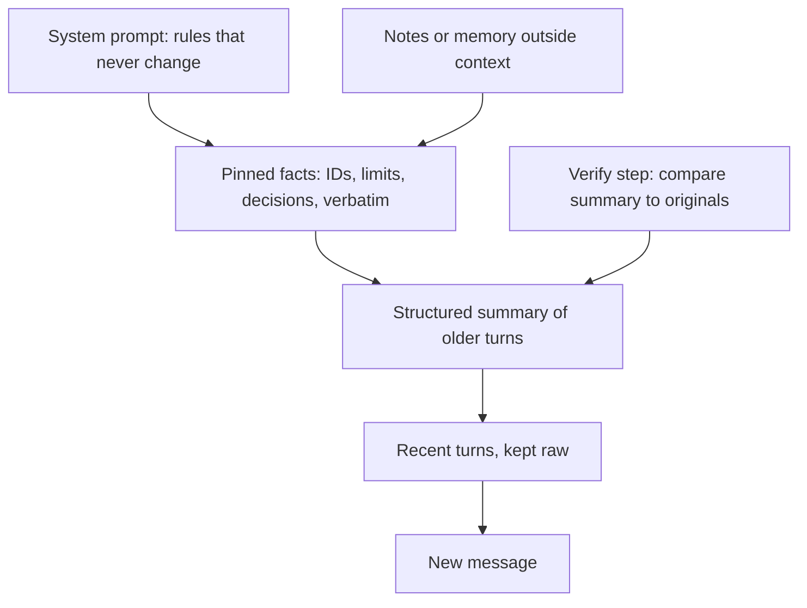

# Summarizing earlier messages without vague assumptions

Free-prose summaries lose numbers, limits and names, and the model fills the gaps with guesses. Summarize into a fixed template instead.

## Same conversation, two summaries

Vague: "User had a slow service, some actions were taken, needs follow-up soon."
Lost: numbers, limits, names, unknowns.

Structured:

```
Goal: find cause of checkout slowness
Facts: p95 2.4s since deploy v142, 14:05
Constraint: no restarts before 18:00
Done: paged on-call (Priya)
Unknown: database health, not checked
Next: compare errors in v141 vs v142
```

## Techniques

1. Fixed template with named fields (goal, facts, constraints, decisions, done, open questions, next step). Write "none" instead of leaving a field blank.
2. Copy IDs, numbers, names, file paths and error messages exactly. Never paraphrase them ("the order" becomes "order 8841").
3. Separate confirmed facts (the user or a tool said it) from assumptions and unknowns. Do not turn an unknown into a fact.
4. List open questions explicitly, so the model asks instead of guessing.
5. Keep the last few turns raw and summarize only older turns.
6. Pin durable facts (IDs, limits, decisions) in a block that is never summarized, and store them outside the context (notes file or memory).
7. Record the reason for each decision, in a few words.
8. Trim bulky tool results to the fields that matter instead of dropping them entirely.
9. Verify the summary: check that the numbers and constraints from the original are still there, or test whether key questions can be answered from the summary alone.



## A summarizer prompt to copy

```
Summarize the conversation so far for an assistant that has no other memory of it.

Use exactly these sections: Goal, Confirmed facts, Constraints, Decisions, Done so far, Open questions, Next step.

Rules:
- Copy IDs, numbers, names, file paths, and error messages exactly. Never paraphrase them.
- Put a fact under Confirmed facts only if the user or a tool result stated it. Do not infer.
- If a detail was never stated, write "not stated". Never fill the gap with a guess.
- For each decision, give the reason in a few words.
- List every unanswered question under Open questions.
- If a section has nothing, write "none".
```

It uses the sentence patterns from `05-writing-clear-instructions.md`: imperative opener, absolute rules, a fallback ("not stated"), and a reason for decisions.
