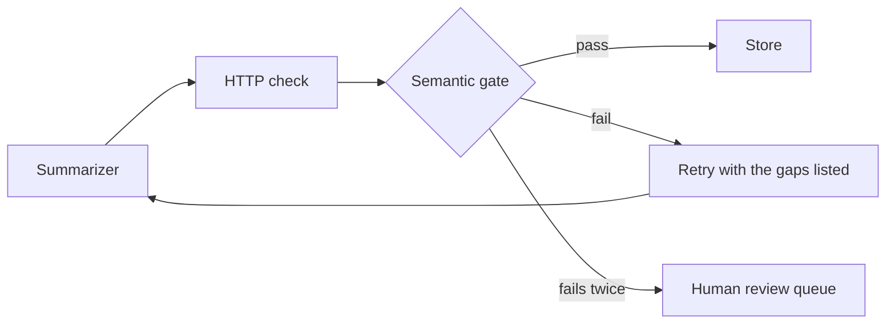

# Semantic validation gate

## The scenario

A summarization service processes 40,000 documents nightly. Monitoring tracks HTTP error rates and retries any 5xx. Leadership reads the near-zero error rate as proof of quality. An audit finds many summaries that silently omit key clauses yet returned successfully.

The gap: there is no semantic validation gate. A 200 OK proves the service ran, not that the output is correct.

- Loud failures (timeouts, 5xx) are seen by monitoring and fixed by retries.
- Silent failures (200 with a wrong or incomplete summary) are seen by nothing.

Leadership was reading a health metric as a quality metric.

## Where the gate sits



It sits between generation and saving. Nothing is marked done until it passes.

## Inside the gate

1. Structure (plain code, cheap, run first): length, format, language.
2. Coverage (LLM judge): is every key clause from the source present, partial or missing?
3. Faithfulness (LLM judge): nothing invented or flipped.

All three must pass. Fail closed: any gap means not accepted.

## Worked example

The summary returned 200 OK: "Payment is net 30. Either party may terminate with notice."

| Key clause from the source | In the summary? |
|---|---|
| Payment: net 30 days | Covered |
| Termination: 60 days' notice | Partial (60 days missing) |
| Liability cap: $1M | Missing |
| Auto-renewal: 90-day notice | Missing |

Gate: FAIL. Retry with the gaps listed ("missing: liability cap $1M, auto-renewal 90-day notice, the 60-day notice period"). A second attempt that includes them passes. If it fails twice, the document goes to the human review queue.

## Design rules

- The checklist of key clauses comes from the source document (an extraction step or a rubric per document type), never from the summary being checked.
- The judge uses its own prompt, separate from the one that wrote the summary.
- Retry with the specific gaps, not blindly. Cap the retries, then escalate to a person.
- Measure quality: first-pass semantic rate, retry rate, review-queue rate, omissions by clause type. Spot-check some passes by hand to confirm the judge agrees with people.
- Cost at 40,000 documents a night: plain-code checks on all, the LLM judge on high-risk or ambiguous ones, and a random sample of the rest.

Runnable demo: `examples/semantic_gate_demo.py` (offline, the judge is a keyword stub, swap in an LLM call for real use). Its output:

```
HTTP error rate:           0 / 5  (looks perfect)
Semantic pass, first try:  2 / 5
Fixed by retry:            2 / 5
Sent to human review:      1 / 5
```

Exam tip: when monitoring looks perfect but an audit finds bad outputs, the answer is a missing output-quality check (semantic validation or evaluation). More retries, better uptime monitoring or a bigger model will not fix it.

See also the `gated-chains` skill in this repo, which defines script, rule, judge and human gates.
