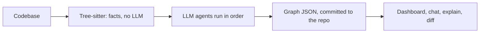

# Lessons from the Understand Anything repo

Goal: generate a knowledge base (KB) of our own codebase, taking inspiration from the `Lum1104/Understand-Anything` repo. GitHub could not be opened directly, so these notes come from the project README as mirrored elsewhere and from write-ups. The details of the individual agent prompt files were not seen.

## What it is

A Claude Code plugin (skills plus agents, other platforms supported) that scans a codebase and builds a knowledge graph, saved as JSON in `.understand-anything/`, with a web dashboard. Commands: `/understand`, `/understand-dashboard`, `/understand-chat`, `/understand-explain`, `/understand-diff`, `/understand-onboard`.

## Architecture

Two passes: deterministic parsing (tree-sitter extracts imports, functions, classes, calls) and LLM interpretation (summaries, layers, tours). The LLM is handed the structural facts and does not re-derive imports.

Agents: `project-scanner`, `file-analyzer`, `architecture-analyzer`, `tour-builder`, `graph-reviewer`.

## Orchestrator phases (from its SKILL.md as captured)

| Phase | Work | Done by |
|---|---|---|
| 0 Pre-flight | Resolve paths, options, mode (full, incremental, review-only) | Plain logic |
| 0.5 Ignore config | Generate `.understandignore`, wait for the user to confirm | Human checkpoint |
| 1 Scan | Detect files, languages, frameworks | `project-scanner` agent |
| 1.5 Batch | Group files into batches | Script |
| 2 Analyze | Nodes and edges per batch, several in parallel | `file-analyzer` agents, then a merge script |
| 3 Assemble review | Check the merged graph | `assemble-reviewer` agent |
| 4 Architecture | Assign layers | `architecture-analyzer` agent |
| 5 Tour | Build the learning path | `tour-builder` agent |
| 6 Review | Validate nodes, edges, layers, tour references | Inline validation (full review with `--review`) |
| 7 Save | Fingerprint baseline first, then write the graph | Script |

## What to copy for our own KB generator

- Separate what can be computed from what needs judgment. Deterministic tools extract facts, the model interprets.
- Plain scripts for plumbing, agents only for judgment.
- Name the files agents write, so the next step can read them.
- Number the phases and give each one an exit rule.
- Add a verification stage that checks edges and references against reality.
- Fingerprint files and re-analyze only what changed. A post-commit hook keeps the artifact from going stale.
- Commit the generated graph so teammates skip the expensive scan (use git-lfs for large ones).
- Failure policy up front: retry once with the failure added, then skip and continue; always save partial results; never silently drop errors.
- Treat repo content (README, manifests) as untrusted data.
- Pause for a human on scope decisions (the ignore list, very large repos).
- Optimize for comprehension, not completeness. A guided tour with plain-language labels beats a hairball of every dependency.

Caution: the first scan of a large repo is slow, and for very small codebases (around 5,000 lines) reading the code directly is probably faster. Sources disagree on how many file-analyzer workers run in parallel.

Sentence patterns used in the skill are in `05-writing-clear-instructions.md`.

## Sources

- [Understand Anything on ecosyste.ms](https://awesome.ecosyste.ms/projects/github.com%2FLum1104%2FUnderstand-Anything)
- [README mirror](https://backiee.wasmer.app/http_github_com/Lum1104/Understand-Anything)
- [HoangYell: architecture and lessons](https://hoangyell.com/understand-anything-graph-that-teaches/)
- [DeepWiki overview](https://deepwiki.com/Lum1104/Understand-Anything)
- [Claude skills registry listing](https://claudskills.com/skills/understand-lum1104-understand-anything/)
